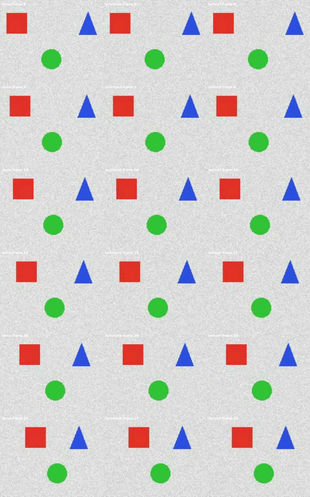

# Day15 응용 07 · 객체 탐지·추적 오류 분석 결과보고서

> **실험 ID:** DAY15-A07-001  
> **작성자:** 고진석/B-02팀<br>
> **작성일:** 2026-11-06<br>
> **데이터 종류:** 실제 YOLO 모델의 영상 추론·추적 결과  
> **모델·가중치:** `data/demo.pt` — 체크포인트 메타데이터상 YOLO26n 구조 기반 2 epoch smoke 학습 설정  
> **버전:** v1.0


## 1. Executive Summary

동일한 모델과 영상에서 ByteTrack과 BoT-SORT를 각각 독립 인스턴스로 실행하여 프레임 처리와 추적 산출물을 비교하였다. 두 조건 모두 30프레임을 처리했으며, 프레임별 CSV의 박스 수는 모두 0이고 추적 상세 행도 0개였다. 출력 AVI 두 파일은 각각 30프레임을 실제로 디코딩할 수 있었다. 영상 GT 90건과 비교한 결과 두 조건 모두 TP=0, FP=0, FN=90으로 모든 정답 관측을 놓쳤다. ID switch는 유효 매칭이 없어 품질 비교 근거로 사용할 수 없으며, 처리 시간만으로 tracker의 우열을 확정할 수 없다.

**핵심 결론:** 두 tracker의 처리·저장 연결은 확인했으나, 기록된 추적 박스가 없어 ID 유지 품질 비교는 미평가이다.

## 2. 실험 개요 및 검증 조건

| 항목 | 설정값 |
|---|---|
| 실험 목적 | 동일 영상에서 tracker 종류에 따른 처리 기록과 산출물 비교 |
| 평가 데이터 | `data/demo.avi` |
| 평가 이미지 수 | 영상 30프레임. 정적 이미지 평가 실험과 구분 |
| 예측 박스 수 | tracker 반환 결과 기준 각 조건 0건. 내부의 추적 전 탐지 후보 수는 미기록 |
| 정답(GT) 박스 수 | 90건: 30프레임 × 프레임당 3개, 실제 개체는 3개 |
| 대상 클래스 | 실습 데이터 정의: square, circle, triangle. 체크포인트의 클래스 매핑도 square=0, circle=1, triangle=2로 일치 |
| IoU 매칭 기준 | 같은 프레임·클래스, IoU ≥ 0.50, 정답 일대일 연결. 예측이 없어 연결 0건 |
| Confidence Threshold | 0.25 |
| NMS 적용 여부 | 사용자 코드의 명시적 NMS 없음. 모델 내부 적용 여부는 별도 확인하지 않음 |
| 데이터 분할 | 제공 영상 사용. 코드에서 train/val/test 이미지 폴더를 읽지 않음 |
| 비교 tracker | `bytetrack.yaml`, `botsort.yaml` |
| 고정 조건 | 같은 가중치·영상, imgsz=160, CPU, stream=True, persist=False |
| 상태 초기화 | tracker마다 새 YOLO 인스턴스 생성 |
| 입력 영상 | 160×128, 10 fps, 30프레임 — 메타데이터 확인 |
| 출력 영상 | MJPG, 160×128, 10 fps |
| 실행 환경 | Windows 경로 기반, CPU 지정. 현재 확인 환경: Python 3.13.16, torch 2.14.0+cu130, torchvision 0.29.2+cpu, ultralytics 8.4.142, OpenCV 5.0.0. 기존 실행 시점 버전 로그는 미보관 |
| 근거 산출물 | tracker 비교 CSV, 프레임별 CSV, 추적 CSV, 출력 AVI |

가중치 파일 식별용 SHA-256:

```text
a1d2ca2fe97fb8e11a3c919a9a542bbe5b6f501b33d29c9d2cb6d39e901d0ed4
```

현재 demo.pt의 내부 train_args는 yolo26n.yaml, epochs=2, pretrained=False, optimizer=SGD, lr0=0.01, seed=42, batch=4, imgsz=160, device=cpu로 기록되어 있다. 생성 메타데이터는 2026-11-06 15:07:42(+09:00), Ultralytics 8.4.202이다. 내부 경로는 다른 작업 환경의 smoke 실행을 가리키며, 현재 로컬 smoke/best.pt와 동일 파일이라고 확인한 것은 아니다. epoch 필드는 -1로 정리되어 있어 실제 완료 epoch 이력은 이 메타데이터만으로 독립 검증할 수 없다.

## 3. 평가 지표 및 결과

### 처리 결과

| Tracker | 처리 프레임 | 박스 0건 프레임 | 추적 행 | 기록된 고유 ID | 경과 시간(초) | 전체 처리량(프레임/초) |
|---|---:|---:|---:|---:|---:|---:|
| ByteTrack | 30 | 30 | 0 | 0 | 3.3824 | 8.8695 |
| BoT-SORT | 30 | 30 | 0 | 0 | 0.2314 | 129.6314 |

두 출력 AVI에서 각각 30프레임을 실제로 읽을 수 있음을 확인했다. 원본과 두 출력 영상의 0·5·10·15·20·29번 프레임을 시각적으로 비교했다. 표본 프레임에서 빨간 사각형·초록 원·파란 삼각형의 위치 변화가 원본과 대응하며, 검은 화면이나 뚜렷한 화면 깨짐은 관찰되지 않았다. 두 출력 모두 예측 박스·클래스 텍스트·추적 ID 표시는 없었다. 이는 CSV의 반환 박스 0건과 일치한다. 전 프레임 육안 판독이나 실시간 재생 검사는 수행하지 않았다.

측정 시간에는 영상 디코딩·추론·추적·시각화·인코딩과 측정 구간 내 최초 실행 비용이 포함된다. 모델 로드와 이후 CSV 저장 시간은 제외된다. ByteTrack이 먼저 실행되었으므로 초기 실행 비용과 실행 순서의 영향을 분리할 수 없으며, 처리량은 순수 모델 추론 FPS가 아니다.

### GT 기반 지표

| 지표 | 값 | 산출 근거 및 미평가 사유 |
|---|---|---|
| TP | 0 | 반환 예측이 없어 GT와 연결된 예측 0건 |
| FP | 0 | 반환 예측 박스 자체가 0건 |
| FN | 90 | GT 90건 모두 미매칭 |
| Precision | 0% (정책값) | 0/0으로 정의되지 않아 zero_division=0 정책 적용 |
| Recall | 0% | 0 / 90 |
| F1-score | 0% | 2×0 / (2×0 + 0 + 90) |
| mAP50 | 미평가 | 이 실행은 model.val()을 수행하지 않음 |
| mAP50-95 | 미평가 | 별도 검증 실습의 결과를 본 영상 실험에 전용하지 않음 |
| ID switch | 미평가 | 프레임별 정답 개체와의 대응 추적 필요 |

**계산 검증:** 두 tracker 각각 `TP+FP=0+0=0`으로 반환 예측 수와 일치하고, `TP+FN=0+90=90`으로 GT 수와 일치한다. GT 90건은 서로 다른 물체 90개가 아니라 3개 물체의 30프레임 관측이다. 매칭할 예측이 없으므로 IoU 계산을 수행할 쌍도 없다.

## 4. 예측별 오류 유형 분석

두 tracker의 상세 CSV는 열 이름만 있고 데이터 행은 없다. 따라서 개별 Prediction ID에 대해 클래스·confidence·Best IoU·오류 유형을 제시할 수 없다.

| Prediction ID | 클래스 | Confidence | Best IoU | 판정 | 상세 내용 |
|---|---|---|---|---|---|
| 해당 없음 | 해당 없음 | 해당 없음 | 미평가 | 오류 유형 미평가 | 두 조건 모두 기록된 추적 박스 0건 |

### 오류 유형별 집계

| 오류 유형 | 건수 | 해석 |
|---|---|---|
| Duplicate FP | 미평가 | GT 매칭과 분류 규칙 적용 미수행 |
| Background FP | 미평가 | 동일 |
| Wrong Class FP | 미평가 | 동일 |
| Loose Box FP | 미평가 | 동일 |
| FN (Miss) | 90 | 각 tracker에서 영상 GT의 모든 프레임별 박스가 미매칭 |

추적 반환 결과에 박스가 없다는 사실만으로 추적 전 탐지 단계에도 후보가 전혀 없었다고 확정하지 않는다.

## 5. 관찰 결과 및 원인 가설

| 관찰된 사실 | 원인 가설 | 추가 검증 계획 |
|---|---|---|
| 두 조건의 30프레임 모두 반환 박스 0건 | 모델의 점수가 기준에 못 미치거나 tracker가 유효 트랙을 구성하지 못했을 가능성 | 같은 영상의 predict 결과와 track 결과를 분리 기록하고 점수 분포·tracker 설정 확인 |
| 두 조건 모두 추적 CSV에 행이 없음 | 탐지 성능 부족, 모델·입력 도메인 차이 또는 연결 기준 영향 가능성 | 가중치 출처·클래스 매핑 확인, 원본과 예측을 정답에 대조 |
| BoT-SORT의 측정 시간이 더 짧음 | 첫 실행 초기화 비용과 실행 순서 영향 가능성 | 워밍업 후 실행 순서를 교차하여 반복 측정하고 중앙값 비교 |
| 두 AVI가 각 30프레임으로 읽히며 표본 6프레임에서 원본 도형에 대응하고 박스·ID 표시는 없음 | 처리·저장 연결은 동작하지만 유효 추적은 확인되지 않음 | 전 프레임 및 실시간 재생을 추가 확인 |

## 6. 개선 계획 및 우선순위

| 우선순위 | 개선 항목 | 방법 | 검증 지표 |
|---|---|---|---|
| P1 | 가중치·입력 계약 확인 | demo.pt의 출처, 클래스 매핑, 입력 영상과의 적합성을 기록 | 파일 해시, 모델 클래스 매핑, 원본 확인 기록 |
| P1 | 탐지와 추적 단계 분리 | 같은 가중치·영상으로 predict와 track 결과를 따로 저장 | 프레임별 탐지 수·추적 수, confidence 분포 |
| P2 | GT 기반 품질 평가 | 영상 GT 박스·개체 ID를 준비하고 클래스·IoU 기준으로 일대일 매칭 | TP·FP·FN, Precision·Recall·F1, ID switch |
| P2 | tracker 조건 확인 | 설정 YAML을 보관하고 한 번에 한 옵션만 변경 | 유효 추적 수, 누락·ID 전환 기록 |
| P3 | 시간 비교 개선 | 동일 환경에서 워밍업 후 순서 교차·반복 측정 | 전체 처리량 중앙값과 변동 범위 |

confidence를 변경하는 후속 실험은 기존 결과와 구분하여 기록하며, 단순히 탐지 수가 늘었다는 이유만으로 개선이라고 판단하지 않는다.

## 7. 종합 판정 및 한계

**최종 판정:** 조건부 PASS — 실행·산출물 연결에 한정하며 탐지·추적 품질은 미평가.

**판정 근거:** 두 tracker에서 각각 30프레임의 처리 기록과 30프레임으로 읽히는 결과 영상을 확인했다. 다만 반환 박스와 추적 행은 모두 0건이다.

**검증하지 못한 부분:** 세부 원인별 오류 진단, ID switch 품질, 추적 전 탐지 후보, 가중치 학습 출처, 표본 외 프레임의 시각적 품질 및 실시간 재생 상태, 다수 반복에서의 시간 변동.

**다음 실험:** 동일 모델·영상으로 탐지와 추적 결과를 분리 수집하고 GT 대조를 먼저 수행한 뒤, tracker 또는 confidence 조건을 하나씩 변경하여 비교한다.

## 8. 증빙 자료

- 코드: [07_project.py](07_project.py)
- 모델: [demo.pt](data/demo.pt)
- 입력 영상: [demo.avi](data/demo.avi)
- 영상 GT: [track_ground_truth.csv](data/track_ground_truth.csv)
- 비교 요약: [tracker_comparison.csv](outputs/tracker_comparison.csv)
- ByteTrack 프레임 기록: [bytetrack_frames.csv](outputs/bytetrack_frames.csv)
- BoT-SORT 프레임 기록: [botsort_frames.csv](outputs/botsort_frames.csv)
- ByteTrack 추적 기록: [bytetrack_tracks.csv](outputs/bytetrack_tracks.csv)
- BoT-SORT 추적 기록: [botsort_tracks.csv](outputs/botsort_tracks.csv)
- 출력 영상: [bytetrack.avi](outputs/bytetrack.avi), [botsort.avi](outputs/botsort.avi)
- 실행 로그: [p07_execution_log.txt](outputs/p07_execution_log.txt)

---

### GT 대조 계산 보충

| Tracker | GT 박스 관측 | 예측 | TP | FP | FN | Precision* | Recall | F1 |
|---|---:|---:|---:|---:|---:|---:|---:|---:|
| ByteTrack | 90 | 0 | 0 | 0 | 90 | 0% | 0% | 0% |
| BoT-SORT | 90 | 0 | 0 | 0 | 90 | 0% | 0% | 0% |

*Precision은 분모가 0이므로 수학적으로 정의되지 않으며, 표에서는 0 처리 정책을 사용했다. 클래스별 GT는 square·circle·triangle 각각 30건으로, 각 클래스의 FN도 각각 30건이다. 이 평가는 tracker가 반환한 박스에 대한 것이며 추적 전 내부 탐지 후보는 별도 평가하지 않았다. ID가 없다는 이유로 ID switch 성능이 우수하다고 판단하지 않는다.


### 출력 영상 시각 판독 증빙

원본·ByteTrack·BoT-SORT 순서로 나란히 배치했으며, 각 행은 0·5·10·15·20·29번 프레임이다. 그림 상단의 영상명과 프레임 번호는 검토용으로 추가한 문구이며 tracker의 예측 표시는 아니다.



관찰 범위에서 원본 도형은 보존되지만 탐지 박스와 추적 ID가 표시되지 않는다. 따라서 영상 저장 상태는 확인했으나 ID 유지·전환의 품질은 평가할 수 없다.

### 동일 조건 재실행 확인

기존 산출물을 outputs/repro_before에 보관한 뒤 동일 스크립트·가중치·영상·CPU 설정으로 재실행했다. 두 tracker 모두 프레임 CSV와 추적 CSV의 값·행 순서가 기존과 일치했다. 출력 영상은 각각 30프레임이며, 디코딩한 모든 프레임의 픽셀 배열도 기존 영상과 완전히 일치했다. 반환 박스와 추적 기록은 다시 모두 0건으로 GT 기반 TP=0, FP=0, FN=90 결과도 동일하다.

처리 시간은 ByteTrack 3.3304→3.4390초, BoT-SORT 0.2247→0.2310초로 변했다. 당시 재실행값을 기록한 것이며, 본문의 처리 결과 표는 이후 사용자 제공 최신 로그·CSV 값으로 갱신했다. 시간 차이는 예측 결과 불일치로 취급하지 않는다. 비교 기록은 [repro_check.csv](outputs/repro_check.csv), 최초 결과는 [기존 요약](outputs/repro_before/tracker_comparison.csv)에 보관했다. 한 번의 재실행 일치는 다른 환경이나 모든 실행에서의 결정성을 보장하지 않는다.

### 제출 전 체크리스트

- [x] CSV의 프레임 수·추적 행 수·시간과 보고서 수치가 일치한다.
- [x] 실제 모델 추론·추적 결과와 수동 Fixture를 구분했다.
- [x] 관찰 사실과 원인 가설을 구분했다.
- [x] 미평가 지표를 측정한 것처럼 표현하지 않았다.
- [x] 후속 실험의 설정과 평가 지표를 제시했다.
- [x] 영상 GT 90건과 반환 예측 0건으로 TP·FP·FN과 지표 계산을 검증했다(Precision 분모 0 정책 명시).
- [x] 원본과 두 출력 영상의 표본 6프레임을 시각 비교했다(전 프레임 육안 검사는 미수행).
- [x] 작성자, 현재 환경 버전, 체크포인트 내부 학습 설정·생성 버전을 보완했다(기존 실행 환경·전체 학습 이력은 미확인).
- [x] 같은 코드·가중치·영상·설정으로 재실행하여 CSV와 영상 픽셀 일치를 확인했다.

